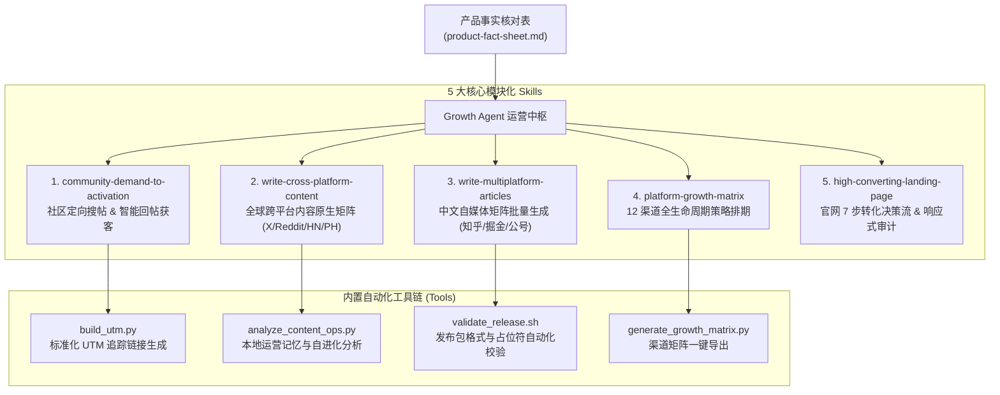

# Universal Growth Agent 🚀
### 全能出海增长与全渠道运营智能体套件

[](https://creativecommons.org/licenses/by-nc/4.0/)
[]()
[]()

> **Universal Growth Agent** 是一个开箱即用、工业级标准的 AI 出海增长与全渠道运营工作流套件。它将顶级独立开发者与专业运营团队经过数月实战验证的运营资产体系化为 **5 个模块化 Agent Skills**、自动化 Python/Bash 工具链与防幻觉事实核对表。
> 
> 无论你是独立开发者、SaaS 创始人、出海团队还是产品经理，只需填入一份产品事实表，即可一键驱动：**社区定向搜帖获客（Reddit/Quora/X）、全球跨平台内容矩阵分发、国内主流自媒体矩阵生成、12 渠道生命周期增长排期、以及高转化官网架构审计**。

---

## 🌟 核心特性 (Key Highlights)

- 🎯 **真实社区定向获客 (Social Listening & Lead Gen)**：自动在 Reddit、Quora、X、YouTube、技术论坛检索高意图提问，智能打分过滤，遵循 10:1 社区贡献比，生成带团队背书的合规回复。
- 🌍 **全球跨平台矩阵分发 (Cross-Platform Native Matrix)**：一句话简报自动定制化生成符合 X、Reddit、Hacker News、Product Hunt、Medium、Dev.to、Hashnode 社区文化的原生推文与技术文章。
- 🇨🇳 **国内多平台内容包一键生成**：一键生成知乎、掘金、微信公众号、CSDN、思否、V2EX 等 18 个平台的专属技术文章、发布总表与配图提示词。
- 📊 **12 大渠道生命周期增长模型**：涵盖从「验证期 -> Beta期 -> Launch期 -> 增长期」的全生命周期运营策略，自动生成定制化 Excel / Markdown 排期表格。
- 💎 **高转化落地页 7 步叙事法则**：彻底告别技术黑话与虚浮的 SaaS 模板，基于 5 秒清晰法则与结果导向叙事，构建高信任、高留存的产品落地页。
- 🛡️ **严格防幻觉与事实边界体系**：内置 `product-fact-sheet.md`，杜绝 AI 擅自承诺“永久免费”、“绝对不可破解”等虚假功能。

---

## 🏗️ 架构与技能编排 (Architecture)



---

## ⚡ 3 分钟快速上手 (Quickstart)

### 步骤 1：一键安装技能到本地环境
运行安装脚本，一键将全部技能注册至当前电脑的 **Google Antigravity**、**Claude Code** 或 **Codex** 目录：
```bash
git clone https://github.com/kristen7416/universal-growth-agent.git
cd universal-growth-agent
./quickstart.sh install
```

### 步骤 2：初始化你的新产品
为新产品一键创建独立运营空间：
```bash
./quickstart.sh init "MyAwesomeApp"
```
系统将自动生成：
- `MyAwesomeApp-growth/product-fact-sheet.md`（产品事实表）
- `MyAwesomeApp-growth/campaign-brief.md`（营销战役简报）
- `MyAwesomeApp-growth/operations-memory.json`（运营记忆底座）
- `MyAwesomeApp-growth/growth-matrix.md`（12 渠道排期表）

### 步骤 3：唤醒 AI 智能体执行任务
在任何支持 Agent 的终端或对话窗口（Antigravity / Claude Code / Codex / Cursor），输入自然语言提示词：

#### 场景 A：社区自动搜帖并撰写高质量回帖
> *"使用 community-demand-to-activation 技能，在 Reddit 和 Quora 搜索关于 [某个痛点/竞品替代] 的最近 30 天提问，按意图匹配度打分，并为前 3 个问题撰写价值第一的专业回答。"*

#### 场景 B：新版本全球跨平台发布包生成
> *"使用 write-cross-platform-content 技能，基于我们刚刚发布的 v1.1 更新日志，分别生成 X 爆款 Thread、Reddit 社区讨论帖、Product Hunt 首发 Maker Story 和 Medium 技术深度长文。"*

#### 场景 C：生成中文 18 平台首发文章矩阵
> *"使用 write-multiplatform-articles 技能，根据这句话：‘一款专为独立开发者打造的无服务器轻量级日志监控工具’，生成知乎、掘金、微信公众号和 V2EX 的专属文章，并运行校验脚本。"*

---

## 🤖 自动发布操作说明 (Automated Publishing Guide)

为了兼顾**全自动执行效率**与**账号安全/合规防封**，本套件采用了工业级的 **“Human-in-the-loop（人工在环确认）+ 双模式熔断”** 架构。

### 1. 运行模式切换 (Operating Modes)

| 模式 | 触发方式 | 行为表现 | 适用场景 |
| :--- | :--- | :--- | :--- |
| **Search and Draft**<br/>*(默认推荐)* | 常规提问，如：<br/>`"帮我找几个 Reddit 帖子并写好回答"` | **只读安全执行**：仅搜索、分析、打分并生成拟回复 Markdown 草稿与 UTM 链接，**不对外部平台发起任何写操作**。 | 日常需求监控、选题沉淀、批量草稿审阅 |
| **Search and Publish**<br/>*(自动发布)* | 包含明确授权动词，如：<br/>`"确认内容无误，请直接发布"` / `"post this"` | **自动写操作**：调用浏览器控制工具或官方 API，打开目标页面，校验登录态，填入草稿并提交，提交后抓取公开可见链接归档。 | 确认无误后的自动化分发、常规官方通告发布 |

---

### 2. 自动发布的两种底层实现途径

#### 途径 A：无头/本地浏览器自动化 (Browser Session Mode) —— 推荐 ⭐
* **适用平台**：Reddit, Quora, X (Twitter), 知乎, V2EX, 微信公众号等。
* **实现原理**：通过 Agent 的浏览器工具（如 Chrome DevTools MCP、Playwright 或已连接的浏览器 Debug 端口），**直接复用您在 Chrome 中已经正常登录的真实账号 Session**，无需在脚本中配置明文密码。
* **执行流程**：
  1. Agent 导航至目标帖子 URL；
  2. 自动检查页面上是否有您的登录头像（确认登录态）；
  3. 智能定位评论框或富文本编辑器，输入适配好的 Markdown/纯文本；
  4. 触发发布按钮，并等待网络请求完成；
  5. 重新刷新或滚动至新评论，确认评论已公开可见（防隐形封禁 Shadowban）。

#### 途径 B：官方 API / CLI 自动化 (API Token Mode)
* **适用平台**：GitHub Releases/Issues (`gh` CLI)、X (Twitter API)、Dev.to API、Hashnode API 等。
* **实现原理**：通过配置环境变量或本地系统 CLI 登录态。
* **配置示例**：
  ```bash
  # GitHub 自动发布（直接复用本机 gh 登录态）
  gh release create v1.0.0 --title "v1.0.0 Release" --notes-file ./release-notes.md

  # Dev.to 文章自动发布
  curl -X POST https://dev.to/api/articles \
    -H "api-key: $DEVTO_API_KEY" \
    -H "Content-Type: application/json" \
    -d '{"article": {"title": "...", "body_markdown": "...", "published": true}}'
  ```

---

### 🌐 内置浏览器深度说明 (Built-in Browser Integration)

在 **Google Antigravity**、**Claude Code** 或 **Codex** 等现代 Agent 环境中，本套件深度集成了系统的 **内置受控浏览器（Built-in Browser / Chrome DevTools MCP）**，实现无需编写任何复杂爬虫脚本的开箱即用自动化。

#### 1. 内置浏览器的核心优势
* 🖼️ **所见即所得与截图回传 (Visual Inspection)**：Agent 会在内置浏览器中自动截取网页高清快照并在对话中回显。在正式提交前，您可以直观看到评论框填入后的实际排版、@提及以及 Markdown 渲染效果。
* 🔑 **持久化登录态复用 (Persistent Session & Cookies)**：
  - 内置浏览器能够无缝挂载您本机的常用浏览器配置文件（User Profile），或直接在初次使用时进行一次常规登录；
  - 登录后 Session 与 Cookies 长期保存在本地，**无需在任何配置文件中明文保存密码或敏感 Token**，彻底杜绝凭证泄露风险，且天然继承高权重账号声誉。
* 🎯 **现代动态单页自适应 (SPA & Rich Text Compatibility)**：能够原生解析 React、Next.js、Vue 构建的复杂前端社区（如 Reddit 的新版富文本 Draft 编辑器、知乎动态流、X 的输入框），自动模拟人类鼠标移动与按键延迟，避免触发平台的防机器人检测。
* 🛡️ **人工极速接管 (Human Takeover for CAPTCHA)**：若偶遇滑块验证、Cloudflare 盾或双重验证（2FA），IDE 会直接弹出内置浏览器视窗，您只需随手轻点完成验证，Agent 即可在几毫秒后无缝恢复执行发帖与归档，实现真正安全的人机协同。

#### 2. 各环境调用内置浏览器的快捷方式
* **Google Antigravity 环境**：
  - 在对话框中推荐输入 `/browser` 快捷指令快速呼出内置浏览器面板；
  - 或直接在 Prompt 中要求：“*使用内置浏览器打开 [URL] 并截图*”。
* **Claude Code / Codex 环境**：
  - 依赖内置的浏览器驱动（如 `safe-browser` / `autobrowse` 或 Chrome DevTools MCP），Agent 会在后台自动完成页面加载、元素捕获与事件触发。

#### 3. 内置浏览器实用 Prompt 示例
> **指令 A（填入与审查）**：
> *"请在内置浏览器中导航到该 Reddit 帖子，截取首屏让我确认当前页面状态，随后把审核通过的回复填入评论输入框中（暂不点击提交）。"*
> 
> **指令 B（发帖后验真截屏）**：
> *"发布完成后，使用内置浏览器刷新页面，截取包含我们回复的页面片段，确认该回复处于公开可见状态，而不是被系统屏蔽或折叠。"*

---

### 3. 标准自动发布 4 步执行 SOP

```text
[Step 1: 扫描与初筛]  → Agent 发现 5 个相关帖子，评分并输出草稿表格
         ↓
[Step 2: 人工一键过目]  → 您扫一眼回复质量，确认产品描述与 UTM 正确
         ↓
[Step 3: 授权下发指令]  → 对 Agent 发送指令：“同意候选 1 和 3，执行自动发布”
         ↓
[Step 4: 自动化提交验真] → Agent 驱动浏览器发布，回填公开 URL 与追踪标记
```

#### 开箱即用自动发布 Prompt 示例：
> **用户**：*"我在浏览器里已经登录了 Reddit 账号。请使用 community-demand-to-activation 技能的 Search and publish 模式，将刚刚审核通过的回答直接发布到该帖子：https://reddit.com/r/productivity/comments/xyz123/ ，发布后把最终确认链接和时间戳记录到 operations-memory.json 中。"*

---

### 4. 自动发布的“安全熔断机制” (Safety Brakes)

为了保障您的社交媒体账号安全，本套件内置了严格的**自动熔断拦截规则**，遇到以下任一情况，Agent 将立即终止发布并提示人工接管：

1. 🛑 **CAPTCHA 人机验证拦截**：如果页面弹出 Cloudflare、reCAPTCHA 或滑动验证，立即暂停，绝不盲目重试，交由人工完成验证后继续。
2. 🛑 **登录态失效保护**：如果检测到当前页面跳至 `/login` 或需要输入密码，立即停止，杜绝未登录态导致的提交失败。
3. 🛑 **版规红线检测**：如果目标版块被标记为严格禁止自荐（如 r/privacy 等敏感 Subreddit），Agent 会强制剥离外链与推广句，自动降级为“纯技术公益解答”。
4. 🛑 **频控防护 (Rate Limit)**：单平台连续发布间隔严格限制，避免触发平台的防灌水垃圾检测算法。

---

## 📂 目录结构清单 (Repository Structure)

```text
universal-growth-agent/
├── README.md                           # 中英双语完整使用手册
├── LICENSE                             # MIT 开源协议
├── quickstart.sh                       # 一键技能安装与产品初始化 CLI
├── agents/
│   └── growth-agent.md                 # 顶层 Growth Agent 角色编排与调度逻辑
├── skills/
│   ├── community-demand-to-activation/ # 技能 1: 社区搜帖、意图评估与合规引流
│   │   ├── SKILL.md
│   │   ├── references/content-guidance.md
│   │   └── scripts/build_utm.py
│   ├── write-cross-platform-content/   # 技能 2: 全球多平台原生内容定制 (X/HN/PH/Reddit)
│   │   ├── SKILL.md
│   │   ├── references/
│   │   │   ├── content-package.md
│   │   │   ├── learning-loop.md
│   │   │   └── platform-guides.md
│   │   └── scripts/analyze_content_ops.py
│   ├── write-multiplatform-articles/   # 技能 3: 中文主流开发者社区文章矩阵
│   │   ├── SKILL.md
│   │   └── scripts/validate_release.sh
│   ├── platform-growth-matrix/         # 技能 4: 12 渠道 4 阶段全生命周期策略
│   │   ├── SKILL.md
│   │   └── scripts/build_platform_workbook.mjs
│   └── high-converting-landing-page/   # 技能 5: 官网 7 步决策转化叙事与响应式审计
│       └── SKILL.md
├── templates/                          # 开箱即用项目模板
│   ├── product-fact-sheet.md           # 产品事实核对表（核心防幻觉基础）
│   ├── campaign-brief.template.md      # 营销战役规划模板
│   └── operations-memory.template.json # 平台数据自进化记忆底座
└── tools/                              # 命令行开箱即用小工具
    ├── build_utm.py                    # UTM 链接生成器
    ├── generate_growth_matrix.py      # 12 渠道排期生成脚本
    ├── analyze_content_ops.py          # 运营数据分析器
    └── validate_release.sh             # 发布文章格式审查脚本
```

---

## 🛠️ 详细技能指南 (Deep-Dive Skills)

### 1. `community-demand-to-activation` (社区意图拦截与精准引流)
* **核心哲学**：**回答优先，顺带引荐**（Value-First, Soft-Pitch）。如果把推荐产品的那句话删掉，这个回答依然必须是全网质量最高、最能解决题主问题的答案。
* **5 维评分机制 (1-5分)**：
  - `Recency (新鲜度)`：优先 48 小时以内的活跃讨论；
  - `Specificity (具体度)`：优先环境明确、痛点卡点的具体问题；
  - `Product Fit (契合度)`：必须确实能解决该问题才发帖；
  - `Added Value (增量价值)`：不复读已有答案，给出深度对比或步骤；
  - `Community Permission (社区许可)`：严格避开锁帖、禁止自荐的板块。

### 2. `write-cross-platform-content` (全球跨平台内容矩阵)
* **拒绝一稿多发**：同一句话根据不同社区的“文化偏好”彻底重写结构：
  - **X (Twitter)**：核心反直觉观点 + 短平快排版 + 结尾挂链接；
  - **Reddit**：真诚请教/开源分享语调，绝对不放未经许可的营销外链；
  - **Hacker News**：严谨客观，详尽阐述技术取舍、性能边界与隐私模型；
  - **Product Hunt**：生动的 Maker Story，讲述开发过程中的挫折与洞见；
  - **Dev.to / Hashnode**：代码实操教程，配架构图。

### 3. `platform-growth-matrix` (12 大渠道全生命周期策略)
* **4 个时期划分**：
  - **验证期 (Validation)**：X / Reddit / Discord 找核心种子用户与痛点；
  - **Beta期 (Beta)**：BetaList / MicroLaunch / Indie Hackers / Loom 1对1 演示；
  - **Launch期 (Launch)**：Product Hunt / Hacker News / AlternativeTo 集中引爆；
  - **增长期 (Growth)**：官网 Blog SEO 矩阵 / YouTube 视频搜索 / 应用商店 ASO 稳固复利。

### 4. `high-converting-landing-page` (高转化落地页体系)
* **5 秒清晰原则**：第一视口拒绝抽象的 3D 悬浮球，5 秒内必须讲清：能帮我达成什么结果？界面长什么样？如何低门槛开始？
* **7 步心理决策流**：
  `结果清晰 -> 真实证明 -> 日常场景 -> 运作原理 -> 安全掌控 -> 定价试用 -> 疑虑消除(FAQ)`。

---

## 🤝 贡献与开源协议 (Contributing & License)

欢迎提交 Issue 和 Pull Request 来完善针对更多垂直平台（如 Threads, 小红书, TikTok）的特定策略！

本项目基于 [Creative Commons Attribution-NonCommercial 4.0 International License (CC BY-NC 4.0)](LICENSE) 授权。供个人与团队自由学习、研究和非商业使用，严禁未经授权用于商业营利目的。

---

**Made with ❤️ for indie hackers, founders, and growth builders worldwide.**
