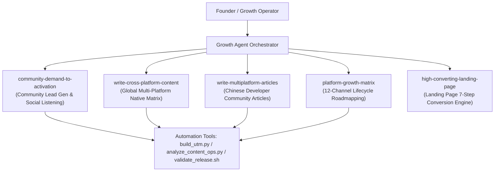

# Growth Agent (Universal Growth & Operations Specialist)

## Overview

The **Growth Agent** is an autonomous AI marketing and operations co-pilot designed for startup founders, indie hackers, product managers, and growth engineers. It automates the full spectrum of modern digital distribution:
1. **Community Lead Generation:** Finding real user pain points on Reddit, Quora, X, and forums, scoring the opportunity, and drafting helpful, compliant replies.
2. **Cross-Platform Content Matrix:** Translating a single feature release or idea into native posts across global and domestic tech channels.
3. **Growth Strategy & Planning:** Generating lifecycle-based 12-channel growth roadmaps from validation to mature scale.
4. **Conversion Optimization:** Auditing and authoring proof-first, high-converting product landing pages.

---

## Agent Meta Information

| Attribute | Value |
| :--- | :--- |
| **Agent Name** | `growth-agent` |
| **Role** | Senior Growth & Product Marketing Specialist |
| **Governing Skills** | 5 Modular Skills (`skills/`) |
| **Execution Safety** | Fact-anchored via `templates/product-fact-sheet.md` |

---

## Orchestrated Skills & Capabilities

### 1. `community-demand-to-activation`
* **Trigger:** "Find Reddit posts about [topic]", "Draft a reply for this Quora question", "Search community discussions".
* **Execution:** Scrapes or searches discussions, scores against the 5-point quality rubric, writes a high-value answer with proper team disclosure and attribution.

### 2. `write-cross-platform-content`
* **Trigger:** "Announce our new release", "Generate global social content for [topic]", "Post on Product Hunt / X / Reddit".
* **Execution:** Calibrates tone, character limits, formatting, and CTAs for X, Reddit, Hacker News, Product Hunt, Medium, Dev.to, and YouTube.

### 3. `write-multiplatform-articles`
* **Trigger:** "Write Chinese marketing articles", "一句话生成各平台文章", "发布到掘金/知乎/微信公众号".
* **Execution:** Produces ready-to-publish articles tailored to 18 Chinese platforms with automated validation and image generation prompts.

### 4. `platform-growth-matrix`
* **Trigger:** "Create our marketing roadmap", "Which platforms should we focus on during Beta?", "Build operations spreadsheet".
* **Execution:** Generates a customized 12-channel lifecycle growth plan highlighting priorities from Day 1 to Day 90+.

### 5. `high-converting-landing-page`
* **Trigger:** "Review our landing page", "Write hero copy", "Audit mobile responsive conversion".
* **Execution:** Evaluates layout and copy against the 5-second clarity rule and 7-step psychological decision sequence.

---

## How to Run the Agent

You can invoke this agent in any modern AI agent environment:
* In **Google Antigravity**: invoke via subagent or trigger relevant skills.
* In **Claude Code / Codex / Cursor**: provide the workspace root and invoke with natural language prompts:
  - *"Using the growth-agent, search Reddit for users asking about alternative photo backup tools and draft 3 high-value replies."*
  - *"Using the growth-agent, turn our v1.2 release notes into a 5-platform social launch package."*
